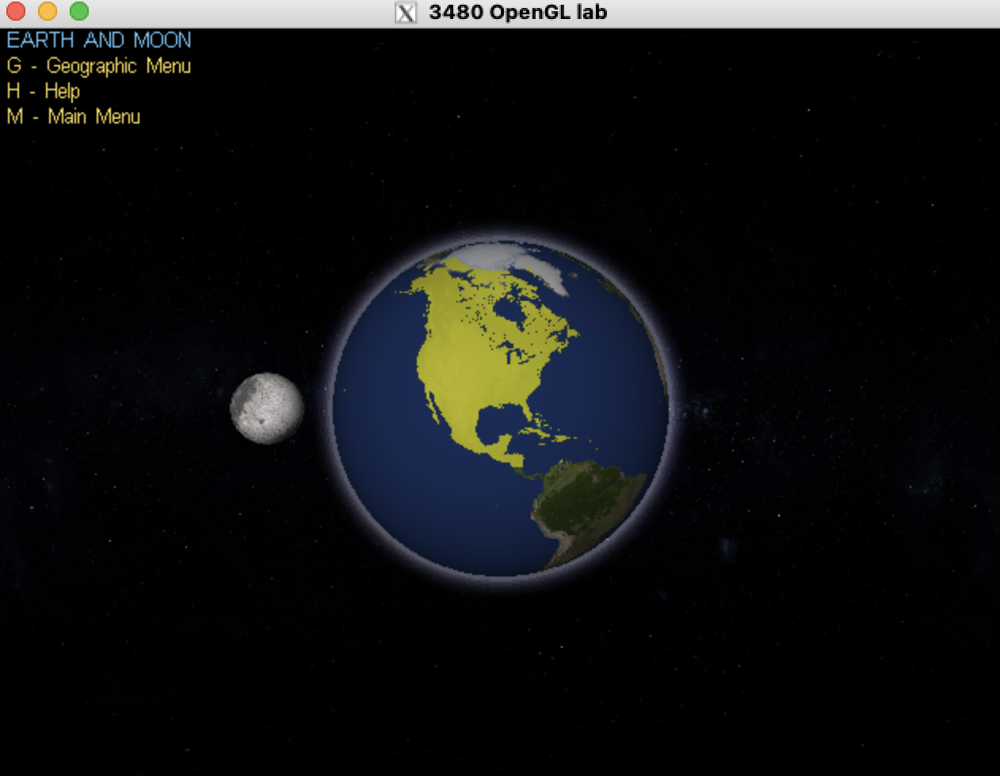
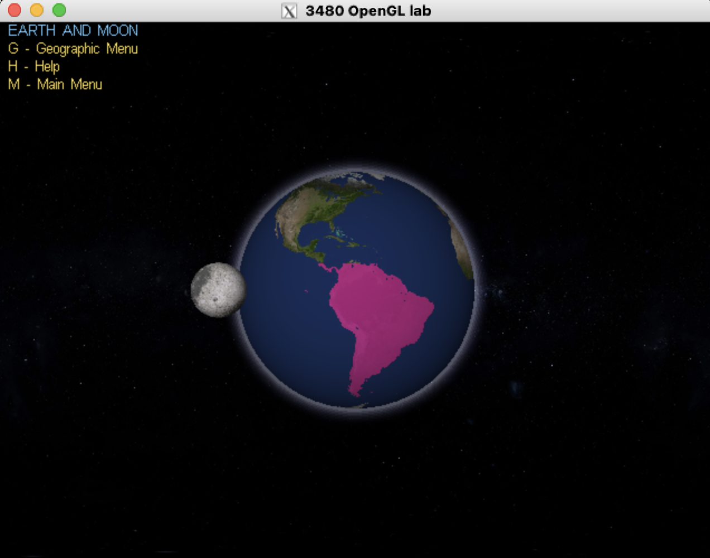
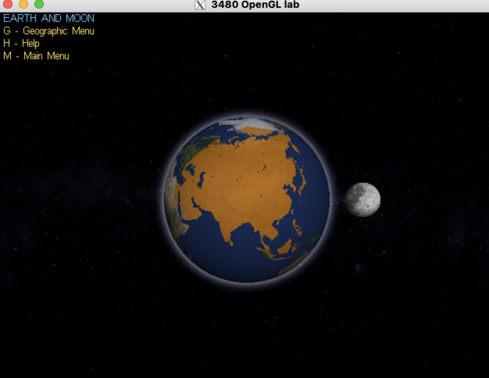
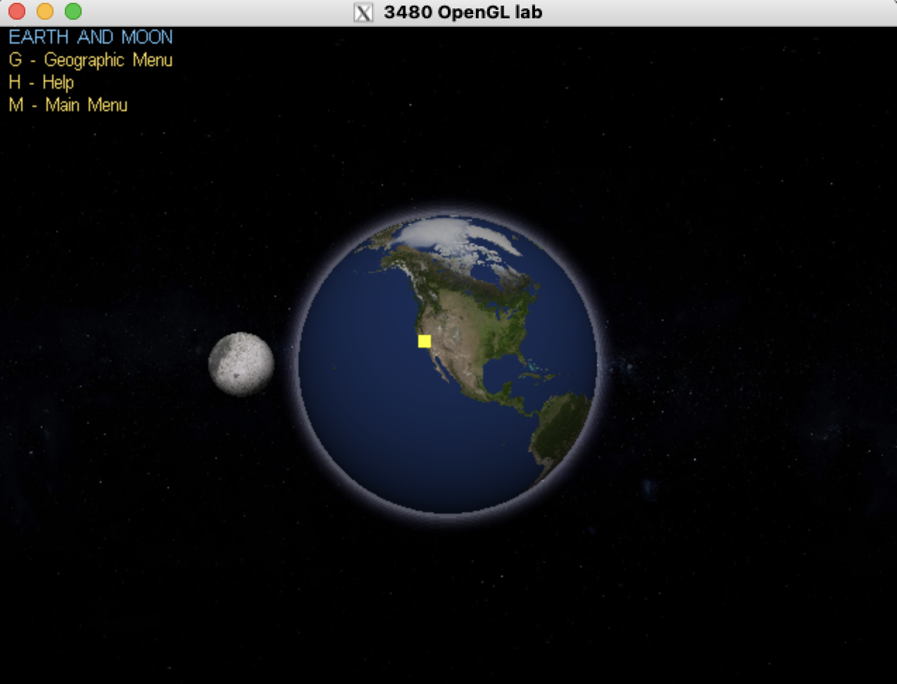
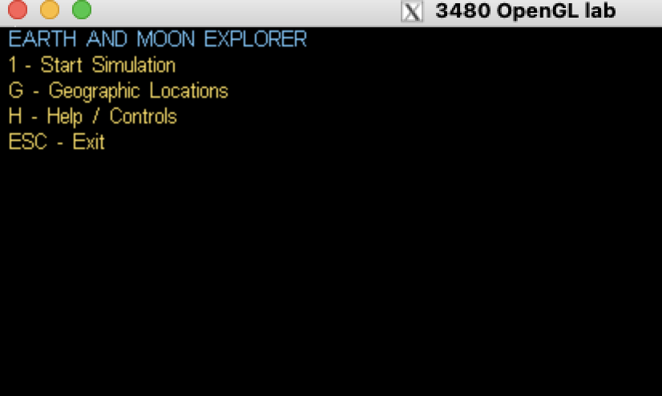
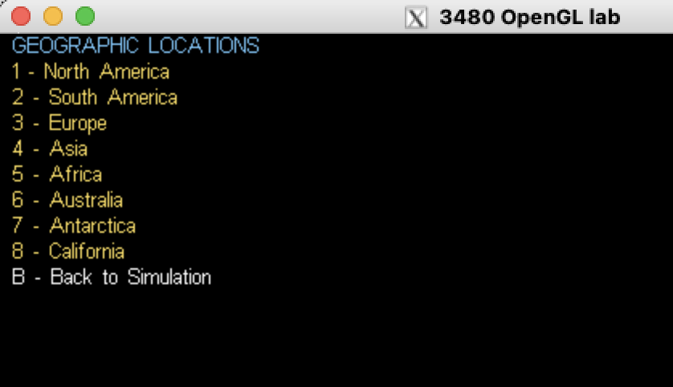

# 🌍 Interactive 3D Earth & Moon Explorer

An interactive 3D Earth and Moon simulation developed in **C++ using OpenGL and X11** as part of CMPS 3480 – Computer Graphics at California State University, Bakersfield.

The project combines 3D rendering, texture mapping, geometric transformations, lighting, and keyboard interaction to create an educational visualization of Earth and the Moon.

## Features

- **3D Earth Rendering:** Textured spherical Earth with continuous rotation.
- **Moon Animation:** A textured Moon orbiting Earth.
- **Geographic Explorer:** Keyboard-based menu for selecting continents and geographic locations.
- **Continent Highlighting:** Geographic regions highlighted using RGB pixel manipulation and texture updates.
- **Automatic Location Focus:** Smooth rotation toward selected locations using shortest-path angular calculations.
- **California Marker:** A geographic point calculated using latitude, longitude, and trigonometry.
- **Atmospheric Glow:** Layered transparent spheres create a glow surrounding Earth.
- **Lighting:** OpenGL lighting provides depth and shading.
- **Galaxy Background:** Space-themed textured background.
- **Interactive Controls:** Keyboard navigation, rotation speed adjustments, pause, and resume.

## 📸 Project Gallery

### Geographic Explorer

| North America | South America |
|:---:|:---:|
|  |  |

| Asia | California |
|:---:|:---:|
|  |  |

### Interactive Menus

| Main Menu | Geographic Menu |
|:---:|:---:|
|  |  |

### 🎬 Earth Rotation Demonstration

[Watch the Earth & Moon Rotation Video](screenshots/Rotationn.mp4)

## Geographic Explorer

| Location | Highlight |
|---|---|
| North America | Yellow |
| South America | Pink |
| Europe | Cyan |
| Asia | Orange |
| Africa | Yellow |
| Australia | Planned |
| Antarctica | Planned |
| California | Yellow marker |

Geographic highlighting uses approximate pixel-based masks rather than precise geographic boundary datasets.

## Controls

| Key | Action |
|---|---|
| `1` | Start simulation |
| `G` | Open geographic menu |
| `H` | Open help menu |
| `M` | Return to main menu |
| `B` | Return to simulation |
| `1–8` | Select a location from the geographic menu |
| `+` | Increase rotation speed |
| `-` | Decrease rotation speed |
| `Space` | Pause/resume animation |
| `Esc` | Exit |

## Technologies

- C++
- OpenGL / GLU
- X11 / GLX
- Texture mapping and RGB image processing
- 3D transformations and trigonometry
- Linux development environment

## Build and Run

The project uses a Makefile and an X11/OpenGL-compatible Linux environment.

```bash
make
./project
```

The program requires the provided support files and image textures.

## Project Webpage

[View the CMPS 3480 project webpage](https://www.cs.csub.edu/~rkaur/3480/project.html)

## Development Status

**Work in progress.** The simulation and geographic exploration features are being developed and refined, including continent highlighting, location positioning, and user interaction.

## Academic Acknowledgment

Developed for CMPS 3480 – Computer Graphics at California State University, Bakersfield.

The project uses course-provided OpenGL/X11 framework components. Ownership and licensing of third-party textures and course-provided materials remain with their respective creators.
